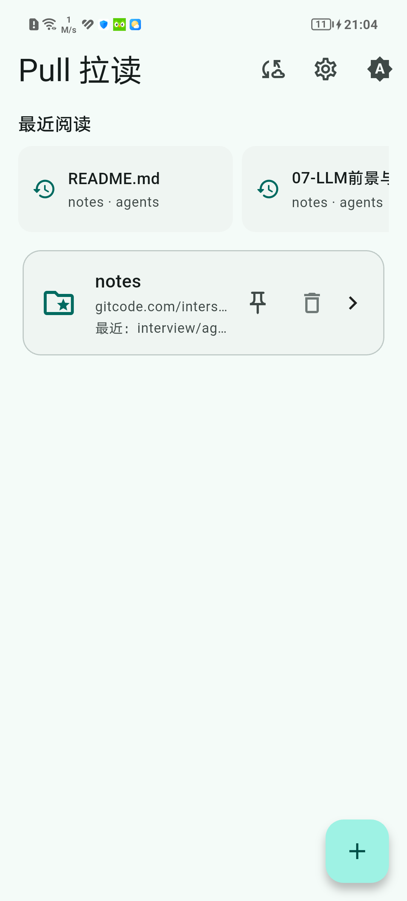
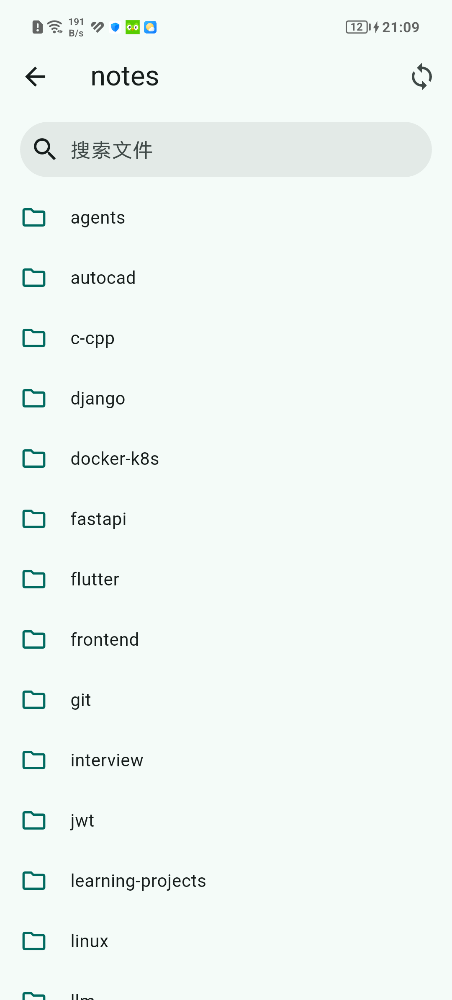
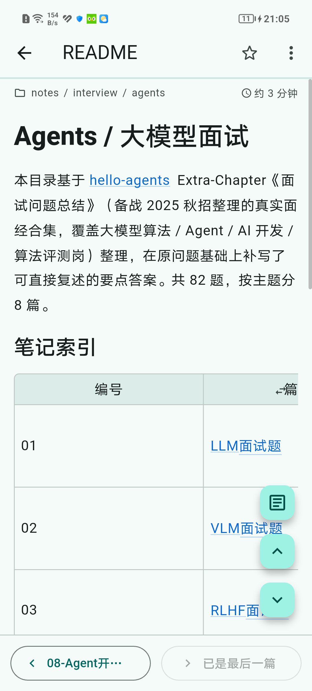
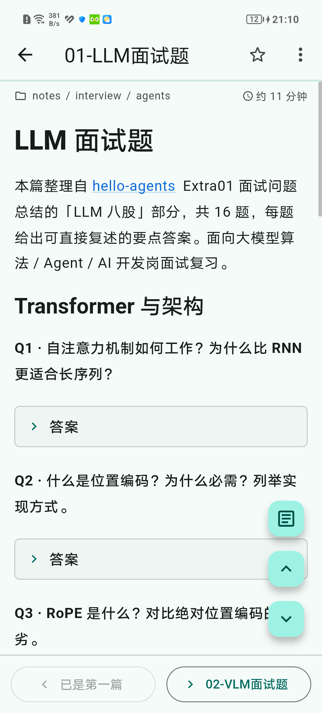
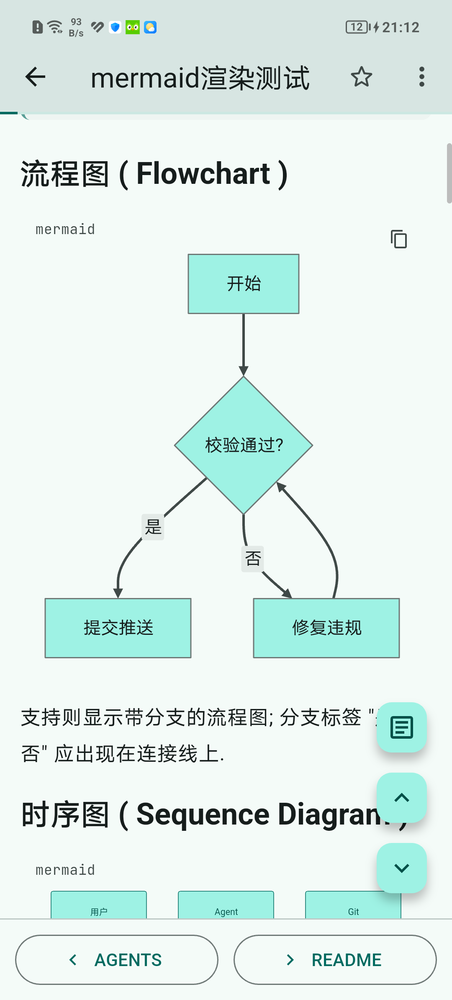
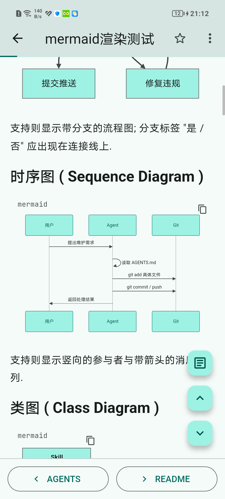

<div align="center">


# PullRead

**把笔记仓库装进口袋的原生阅读器**

*GitHub / Gitee / GitCode 笔记仓库克隆到手机，零部署、零构建托管，仓库本身即数据源*

[](#-下载)
[](https://flutter.dev)
[](https://github.com/interset-wq/pullread/releases)
[](LICENSE)

</div>

---

## ✨ 功能特性

### 📄 Markdown / GFM 渲染
- **GFM 告警框**：`> [!NOTE]` / `[!TIP]` / `[!IMPORTANT]` / `[!WARNING]` / `[!CAUTION]` 渲染为彩色提示卡
- **表格**：平铺（按内容自然宽度横向滚动）与换行（限两倍屏宽均分列宽）双档，每个表格右上角独立切换
- **折叠块**：`<details>/<summary>` 渲染为可点击卡片，内部代码块/表格/列表正常渲染，`open` 属性生效
- **代码高亮**：190+ 种语言，一键复制、行号、长代码自动折叠
- **Mermaid 图表**：28 种图类型原生渲染（流程图、时序图、类图、状态图、ER 图、甘特图、饼图、gitgraph、思维导图、时间线、桑基图等），超宽自动缩放，点按进全屏缩放查看
- **数学公式**：KaTeX 行内 `$...$` 与块级 `$$...$$`，金额（`$100`）等场景不误判
- **Jupyter Notebook**：`.ipynb` 直接转 Markdown 渲染
- **HTML 兼容**：内联/块级 HTML 标签自动转换

### 📡 克隆与同步
- 通过统一抽象层（`RepositoryAdapter`）接入 GitHub / Gitee / GitCode，业务代码不绑定任何平台 API
- 整仓克隆；启动时可选自动拉取同步（设置内开关，默认关闭），仓库页支持下拉/按钮手动刷新
- 克隆有进度可取消：显示对象数与已下载体积，取消后清理半成品目录，重试不会撞上「目录已存在」
- 同步可感知：仓库卡显示上次同步时间；仓库页「更多 → 检查更新」先告知落后多少个提交，再决定是否拉取；
  拉取后新增/更新的文件在列表里打角标，打开即清除
- 远端改写历史导致无法 fast-forward 时提示「重新克隆」，不覆盖本地阅读进度与收藏
- 只读定位：不含任何编辑 / commit / push 功能；当前仅支持公开仓库

### 🗂 目录浏览
- 按原目录结构浏览（目录树不扁平化），支持子目录逐级进入、快速回到仓库根
- 文件列表可按名称或最近修改排序（仓库页工具栏一键切换）
- 非 Markdown 文件用语法高亮只读查看，代码行号同步滚动、右侧贴边滚动条

### 📁 本地文件夹
- 不经过 git 也能读：Android 经 SAF 授权任意文件夹（一次授权持久生效，可移除），桌面直接选目录
- 授权后**增量镜像**到应用私有目录，复用与仓库完全相同的浏览/渲染/搜索/进度/导出管线
- 支持 md / ipynb / 代码 / 图片，`.txt` 自动识别 UTF-8 与 GBK 编码按纯文本阅读
- 本地 md 可直接编辑：源码 + 预览切换、手动保存、未保存离开提醒；保存时同时写回镜像与原文件夹，
  写回失败会记账并在下次同步时自动重试（设置「数据 → 未写回的修改」可查看/重试/强制覆盖）
- 边界不变：仍然不做 git 提交，仓库内文件只读

### 🔍 检索
- **仓库内搜索**：文件名 / 正文双模式；正文按文件分组，显示命中次数与上下文高亮摘要
- **跨仓库搜索**：首页搜索入口一次检索所有仓库的正文，结果按仓库分组；支持搜索历史（最多 12 条）、
  按仓库多选过滤、「正文 / 仅标题」两种模式
- **标签**：聚合各仓库（含本地文件夹）front-matter 的 `tags`，点标签按 AND 跨仓库筛选；
  可开启「目录名隐式标签」，没写 front-matter 的仓库也能用标签导航
- **断链检查**：仓库页「更多 → 检查断链」，列出失效的相对链接/图片并可复制清单

### 🧭 阅读体验
- 文章目录（TOC）浮动按钮 + 回顶/回底按钮
- 文首面包屑：`仓库 / 目录 / 子目录` 逐级可点，直接落到对应目录页
- 底部常驻翻页条：上一篇/下一篇不必滚到文末；文末另有「上级目录 / 仓库首页」按钮
- 阅读进度记忆：按文件保存滚动位置，重新打开自动恢复（不再弹窗询问，「从头读」一键撤销）
- 搜索结果直达：从正文搜索点进文章会自动打开查找条并定位到第一处命中
- 文内查找：命中计数 + 上一处/下一处，按所属章节定位并预览命中行
- 收藏文章 / 最近阅读：首页横滑条目，点击直达（跨仓库）
- 继续阅读：首页顶部卡片直接回到上次读到的位置（进度在 2%~98% 之间时出现）
- 屏幕常亮：设置中开关，阅读页内生效，离开自动释放

### 🎨 外观
- 深色模式：跟随系统 + 手动切换
- 代码字体可选（JetBrains Mono / Consolas），默认关闭连字
- 桌面图标五选一（设置内切换）
- 阅读排版可调：正文行距、页边距、字号五档

### 💾 数据与存储
- 远程图片磁盘缓存：命中即出图（离线可读），总量上限 200MB 按最久未用淘汰，
  超 7 天在后台用 ETag / Last-Modified 条件请求静默刷新，不重传图片本体
- 存储占用页：分别统计仓库 / 本地镜像 / 图片缓存 / 元数据的体积，图片缓存可一键清理

## 📸 截图预览

| | |
|---|---|
|  |  |
| *首页：最近阅读与仓库管理* | *目录树：按原结构浏览* |
|  |  |
| *阅读页：表格与 TOC* | *折叠块：点击展开答案* |
|  |  |
| *Mermaid 流程图* | *Mermaid 时序图* |

## 📥 下载

前往 [Releases](https://github.com/interset-wq/pullread/releases) 下载最新 Android APK
（arm64-v8a，约 32MB，覆盖主流机型；tag 推送后由 GitHub Actions 自动构建发布）。

## 🚀 快速开始

```bash
git clone https://github.com/interset-wq/pullread.git
cd reader
flutter pub get
flutter run                 # 运行（连接设备/模拟器）
flutter analyze             # 静态检查
flutter test                # 测试
flutter build apk --split-per-abi --target-platform android-arm64  # 构建 release APK（arm64）
```

> 发版流程：更新 `pubspec.yaml` 的 `version`（如 `1.10.5+15`）→ 提交 → 打同名 tag（`v1.10.5`）并推送，
> GitHub Actions 自动校验版本一致、构建 arm64 APK 并创建 Release——无需手动上传。

> 首次运行需在手机浏览器完成应用权限（存储路径在系统默认目录下的 `reader/` 仓库根）。

## 🧱 技术栈

- **框架**：Flutter（Dart 3 / Flutter 3.47+），主要目标 Android，另含 Windows 桌面端用于本机预览调试
- **git 层**：libgit2 FFI（git2dart），仅使用克隆 / pull 只读能力；git 操作在后台 isolate 执行，避免大仓库卡 UI
- **渲染**：markdown_widget + flutter_math_fork（KaTeX）+ mermaid_flutter（Mermaid 图表）
- **存储**：shared_preferences（偏好设置）；阅读进度/收藏/最近阅读以 JSON 存于仓库旁 `.meta/` 目录，随仓库走

## 🗂 目录结构

```
lib/
├── main.dart               # 入口（libgit2/SSL 初始化顺序见 AGENTS.md）
└── src/
    ├── git/                # git 同步服务、仓库元数据（.meta/）
    ├── platforms/          # RepositoryAdapter 抽象层 + GitHub/Gitee/GitCode 适配器
    ├── notes/              # 笔记扫描、TOC、GFM 告警、折叠块、ipynb 转换、数学公式、Mermaid、标签、断链
    ├── local/              # 本地文件夹授权 / 增量镜像 / 写回待办
    ├── search/             # 正文检索纯逻辑（仓库内与跨仓库共用）
    ├── ui/                 # 首页、仓库页、阅读页、编辑器、代码查看、图片缓存、设置与存储页
    ├── theme/              # 主题、偏好设置（AppPrefs）
    └── utils/              # 自然排序、文本编码、纯文本提取、目录体积等工具
```

## 🗺 路线图

后续方向与已完成功能见 [Roadmap.md](Roadmap.md)（含明确的非目标边界）；
按代码缺口排出的分批落地计划见 [Roadmap.agent.md](Roadmap.agent.md)。

## 📄 许可证

[MIT](LICENSE)
